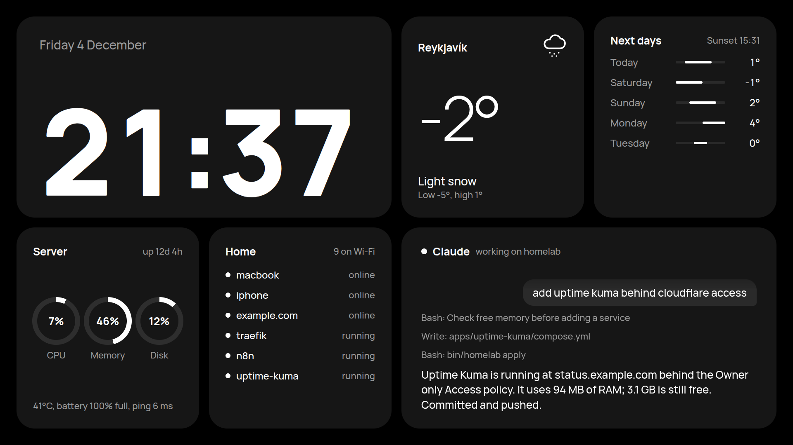
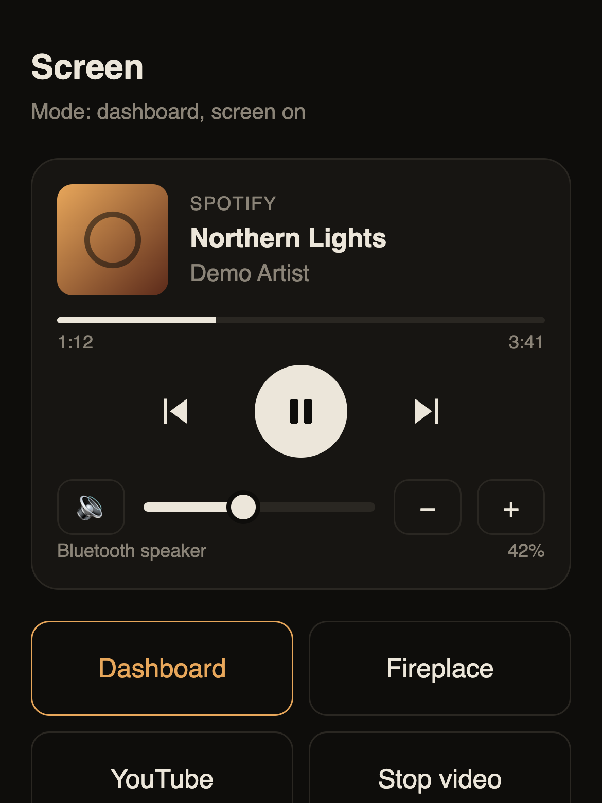
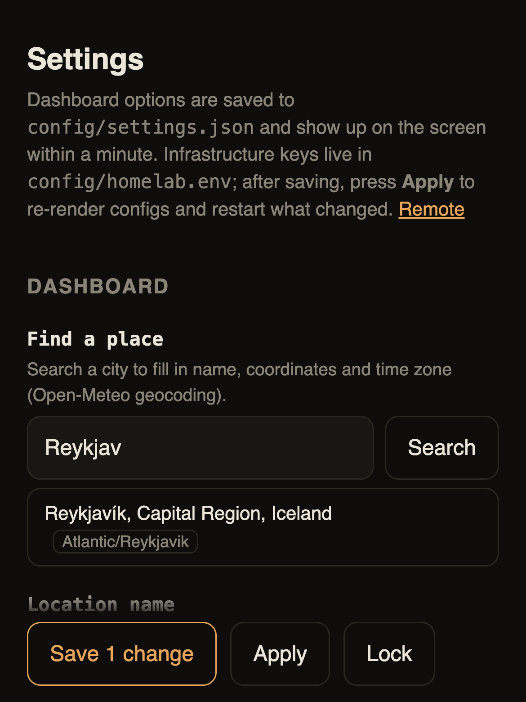

<div align="center">

# ▍homelab

**an old laptop, lid closed, running the house**

<sub>sway kiosk · traefik · cloudflare tunnel · n8n · airplay · homekit · administered by claude code</sub>

<br>

      

<br>



<sub>the built-in 15″ screen · 1920×1080 · demo data</sub>

</div>

<br>

## ░ details

|                 |                                                                                   |
| --------------- | --------------------------------------------------------------------------------- |
| **machine**     | 2020 15″ laptop · i5-10210U · 8 GB · NVMe · Wi-Fi only · lid closed, screen on    |
| **os**          | Ubuntu Server 26.04 LTS                                                           |
| **wm**          | sway on tty1, no bar, no cursor, one workspace per mode                           |
| **kiosk**       | Chromium `--kiosk`, driven over the DevTools protocol by `screenctl.py`           |
| **dashboard**   | plain HTML, no framework, no build step · weather by [Open-Meteo]                 |
| **modes**       | dashboard · fireplace · YouTube TV (cast target) · AirPlay ([UxPlay]) · mpv       |
| **remote**      | phone page (Spotify, volume, modes) · Apple TV Remote + iPhone volume keys ([HAP-python]) |
| **proxy**       | Traefik v3, Docker labels, one `compose.yml` per app                              |
| **ingress**     | Cloudflare Tunnel (no open ports) · Cloudflare Access in front of admin UIs       |
| **automations** | n8n + Postgres, SSO through Cloudflare Access, MCP server for Claude Code         |
| **admin**       | Claude Code over Remote Control, every change a git commit                        |
| **font**        | whatever the system ships; the dashboard draws its own icons                      |

<br>

## ░ screens

<table>
<tr>
<td width="50%" valign="top">

<p align="center"><sub><b>remote</b> · <code>:8090</code> · now playing, volume, modes, play any link</sub></p>
</td>
<td width="50%" valign="top">

<p align="center"><sub><b>settings</b> · <code>:8090/settings</code> · dashboard + every infra value</sub></p>
</td>
</tr>
</table>

The screen is one Chromium per mode, each parked on its own sway workspace, so switching is instant and
nothing reloads. Cast a YouTube video from a phone and the screen jumps to it, then back to the dashboard
when it ends. AirPlay and other links play as an overlay on top of whatever mode is on.

<br>

## ░ dashboard pages

Page 1 (clock, weather, server, home, Claude) ships with the repo. Page 2 (calendar, reminders, notes)
appears once a client pushes a snapshot. Every other page comes from the **page builder**: drop a JSON file
into `~/.config/homelab/pages/` and it joins the rotation, the dots, the remote's page switcher and
`POST /api/page/<id>` within a minute. No restart, no code.

That folder lives outside the repo on purpose: a page belongs to whatever project feeds it, so it never
lands in this public repo. Keep the JSON in that project and symlink it in.

```jsonc
{
  "id": "example",              // lowercase, starts with a letter; also the lock id
  "title": "Example",           // remote button label
  "order": 50,                  // pages sort by order, then id
  "refresh": 30,                // seconds between data fetches while the page is visible
  "source": {                   // one of: command (prints JSON) · url (returns JSON) · file (JSON)
    "command": ["python3", "~/my-project/feed.py"], "every": 30, "timeout": 20
  },
  "tiles": [                    // laid out on the 4×2 grid, left to right; w 1–4, h 1–2
    {"type": "stat", "title": "Load", "field": "load", "format": "num", "label": "1-minute average"}
  ]
}
```

| tile | shows | fields |
| --- | --- | --- |
| `stat` | one big value | `field`, `format`, `digits`, `label`/`label_field`, `sub`/`sub_field`, `alert_field` (truthy = warm color) |
| `rows` | status list with dots | `field` → `[{name, value, format?, ok}]` |
| `table` | rows × columns | `field` → `[{…, _dim?}]`, `columns: [{key, label, format, digits, width}]`, `max` |
| `line` | time series, legend, event markers | `field` → `{series: [{name, points: [[x, y]], color?}], markers: [{x, label}], y_format, x_format, x_min, x_max, now}` |
| `bars` | diverging bars around zero | `field` → `[{label, value}]`, `format` |
| `text` | a paragraph | `field` or `value` |

Every tile also takes `title`, `w`, `h`, `head` / `head_field` (top-right text) and `dim_field` (truthy =
the tile is greyed out and loses its alert color, e.g. last week's numbers shown between events). `field` is a dotted path
into the source's JSON (`market.gap`). Formats: `pct` (signed), `pct_abs`, `int`, `num`, `bytes`, `ago` and
`until` (epoch seconds, live countdown), `time`, `daytime`.

The source runs in screenctl (as your user), cached for `every` seconds; a failing source keeps showing its
last data with the error under the page. Pages are only read from disk, so nothing on the network can add
one. A broken file is skipped and reported by `GET /api/pages`. Start from
[`docs/pages/example.json`](docs/pages/example.json).

<br>

## ░ how it fits together

```
                     internet
                        │
              ┌─────────▼─────────┐
              │ cloudflare        │  TLS · Access (SSO) · *.example.com
              └─────────┬─────────┘
                        │ tunnel (outbound only)
┌───────────────────────▼────────────────────────────────────────────────┐
│ laptop                                                                 │
│                                                                        │
│   cloudflared ──► traefik :80 ──► n8n · postgres · docs · <your app>   │
│                                                                        │
│   sway ─┬─ ws1  chromium   dashboard + fireplace  ◄─┐                  │
│         ├─ ws2  chromium   youtube tv (cast)      ◄─┤                  │
│         ├─ ws3  mpv · uxplay overlays             ◄─┤ CDP · swaymsg    │
│         └─ ws4  chrome     spotify web player     ◄─┤                  │
│                                                     │                  │
│   screenctl.py :8090 ───────────────────────────────┘                  │
│        ▲                                                               │
│        └── phone remote · homekit.py · settings page                   │
│                                                                        │
│   config/homelab.env ──► compose .env · cloudflared · systemd units    │
└────────────────────────────────────────────────────────────────────────┘
          ▲
          └── tailscale / LAN only: :8090, ssh, n8n MCP
```

<br>

## ░ tree

```
bin/homelab            setup · doctor · apply · screen
bin/private-git        optional private overlay repo (same work tree, own .git dir)
config/                homelab.env.example (every key, documented)
                       homelab.env · settings.json · public.env stay local
lib/hlconfig.py        reads and writes the config files
traefik/               reverse proxy
cloudflared/           config.yml.tmpl, rendered with your tunnel id and domain
apps/<name>/           compose.yml per app (n8n, docs, hello)
screen/                screenctl.py · dashboard.html · control.html · settings.html
                       homekit.py · sway.config · systemd user units
system/                claude-rc.service (Claude Code Remote Control in tmux)
docs/pages/            example page for the dashboard's page builder
```

<br>

## ░ install

You need an always-on Linux box (Ubuntu Server 24.04+ tested) and ten minutes.

```sh
sudo apt install -y git docker.io docker-compose-v2 && sudo usermod -aG docker $USER   # then log in again
sudo git clone https://github.com/keepggoingg/homelab /srv/homelab && sudo chown -R $USER: /srv/homelab
cd /srv/homelab

bin/homelab setup     # wizard: detects this machine, asks the rest, generates every secret
bin/homelab doctor    # checks everything; each ✗ comes with the command that fixes it
bin/homelab apply     # starts traefik and the apps
```

That's a working homelab on your LAN, no domain needed:

| open | what |
| --- | --- |
| `http://<host>:8090` | remote: Spotify, volume, screen modes |
| `http://<host>:8090/settings` | every setting, unlocked with the token `setup` generated |
| `http://<host>:8090/dashboard` | the dashboard in any browser (an old tablet on the wall works great) |
| `http://<host>:5678` | n8n: create your account right away |
| `http://<host>/guide/` | your private start page |

Everything after that is optional and `doctor` walks you through it:

| want | do |
| --- | --- |
| apps on your own domain, no open ports | domain on Cloudflare → `bin/homelab setup --reconfigure`, then follow `doctor`'s tunnel steps |
| reach it from anywhere, privately | install [Tailscale](https://tailscale.com/download/linux), `setup --reconfigure` picks up its IP |
| the built-in screen (dashboard, fireplace, YouTube, AirPlay) | `bin/homelab screen`, then the packages `doctor` lists |
| your calendars, reminders and notes on the screen | on your Mac: `clients/macos/install.sh http://<host>:8090` (Calendar app accounts incl. Outlook/Exchange, Reminders, chosen Notes) |
| your own dashboard pages | a JSON file in `~/.config/homelab/pages/` (see [dashboard pages](#-dashboard-pages)) |
| the Apple Home remote | the HAP-python venv `doctor` prints, then pair the "TV" in the Home app |
| n8n on `n8n.<domain>` | Cloudflare Access app on it, then `CF_ACCESS_TEAM` + `CF_ACCESS_AUD` (until then n8n stays private: safe by default) |
| the remote on the internet | Cloudflare Access app on `remote.<domain>` first, then set `SCREEN_REMOTE_HOST` |

The repo lives in `/srv/homelab` because the systemd units point there; `doctor` tells you if it doesn't.

<br>

## ░ settings

`http://<HL_HOST>:8090/settings`, unlocked with `SETTINGS_TOKEN` from `config/homelab.env`.

- **dashboard**: city search fills in name, coordinates and time zone; pick which URL the Home tile
  checks. Saved to `config/settings.json`, on screen within a minute.
- **infrastructure**: every key from `homelab.env.example` with its help text. Secrets are write-only:
  the page shows whether they are set, never their value.
- **apply**: runs `bin/homelab apply`, which re-renders templates, restarts cloudflared if its config
  changed, and runs `docker compose up -d` everywhere (only changed containers are recreated).

Port 8090 is meant for the LAN and Tailscale (ufw). To reach the remote from anywhere, put a Cloudflare
Access app on a hostname first, then set `SCREEN_REMOTE_HOST` to it and Apply: Traefik routes it to
screenctl through `traefik/dynamic/screen-remote.yml`. Leave it empty and the route doesn't exist.

<br>

## ░ rules

Everything that identifies one install (domain, IPs, hostnames, IDs, tokens) lives in
`config/homelab.env`. Compose files use `${VAR}`; systemd units read `config/public.env`, which has the
non-secret keys only. Personal files go in the private overlay (`bin/private-git sync`), never here.
See [`CLAUDE.md`](CLAUDE.md): it's the admin's handbook, and the admin is Claude.

<br>

<div align="center"><sub>lid closed · fan quiet · fire on</sub></div>

[Open-Meteo]: https://open-meteo.com
[UxPlay]: https://github.com/FDH2/UxPlay
[HAP-python]: https://github.com/ikalchev/HAP-python
